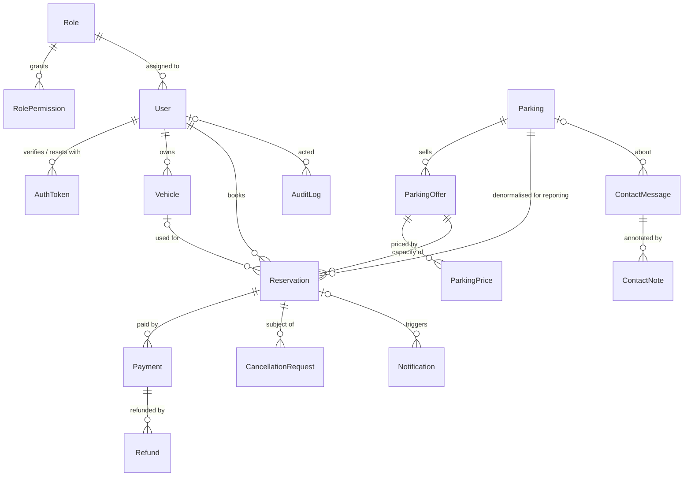

# Data model

Status: **proposal, pending approval.** Source: [`prisma/schema.prisma`](../prisma/schema.prisma)
(valid, and applied successfully to a disposable PostgreSQL 16 database: 19 tables, 16 enums,
58 indexes, 27 foreign keys). No migration is committed before approval.

## Relationships

## Entities

| Entity | Purpose | Key constraints |
|---|---|---|
| **Role** | `CUSTOMER`, `ADMIN`, `SUPER_ADMIN` (system, not deletable) + custom staff roles | `key` unique; `isStaff` gates `/admin` |
| **RolePermission** | Permissions granted to a role | PK (`roleId`, `permission`); `Permission` is a fixed enum checked in code |
| **User** | Customers and staff | `email` unique (normalised); Argon2id `passwordHash`; `sessionVersion` revokes sessions; soft delete + anonymisation |
| **AuthToken** | E-mail verification and password reset | Only SHA-256 `tokenHash` stored, unique; single use (`usedAt`), expiry |
| **Parking** | An airport site (NTE, MRS, CDG, future ones) | `slug` unique; time zone; **configurable rules**: lead time, max stay, horizon, hold TTL, free-cancellation window; `DRAFT/ACTIVE/SUSPENDED`; archived not deleted |
| **ParkingOffer** | A bookable service of a site with its own capacity (ALTERPARK shuttle / ALTERECO walk) | (`parkingId`, `code`) unique; `capacity` |
| **ParkingPrice** | Rate rows of an offer | Validity dates, day range, `FLAT` or `PER_DAY`, extra-day amount, priority; integer cents |
| **Vehicle** | Saved customer vehicles | (`userId`, `plate`) unique; soft delete |
| **Reservation** | A booking | `reference` unique and non-sequential; `idempotencyKey` unique; customer, vehicle and **price snapshots**; `holdExpiresAt`; amounts in cents |
| **CancellationRequest** | Customer request outside the free window | Status, decider, decision note |
| **Payment** | One payment attempt | Provider session / payment ids unique; status; failure details; refunded total. **No card data** |
| **Refund** | Full or partial refund | Provider refund id unique; requested by (staff) |
| **PaymentWebhookEvent** | Webhook idempotency ledger | (`provider`, `eventId`) unique |
| **ContactMessage** / **ContactNote** | Contact form + internal comments | Status workflow; assignment; IP stored only as a salted hash |
| **Notification** | E-mail outbox | `dedupeKey` unique; attempts, next attempt, last error |
| **AuditLog** | Append-only trail of sensitive actions and state changes | Actor (user/system/webhook), action, entity, metadata diff; indexed by entity, actor, action, date |
| **AppSetting** | Global settings edited in the back office | Key → JSON, validated by Zod in code |
| **RateLimitBucket** | Fixed-window counters (serverless-safe) | PK (`key`, `windowStart`) |

## Conventions

- **IDs:** UUID v7 (time-ordered: good index locality, not guessable as sequences).
- **Time:** `timestamptz(3)` in UTC everywhere; the customer enters wall-clock times in the
  **site's** time zone, converted server-side (DST gaps rejected). Rate validity uses `date`.
- **Money:** integer cents + currency. Totals are computed server-side and frozen in the reservation.
- **Snapshots:** a reservation keeps the customer, vehicle and price as they were when booked, so
  editing an account, deleting a vehicle or changing a tariff never alters past bookings or reports.
- **Deletion:** `Restrict` on financial history (reservations, payments, refunds cannot vanish with a
  parent); `Cascade` only for owned details (role permissions, tokens, notes); `SetNull` for optional
  references. Soft delete only where justified (users for GDPR, sites/offers, vehicles).

## Status machines

| Entity | States |
|---|---|
| Reservation | `PENDING_PAYMENT → CONFIRMED → CHECKED_IN → COMPLETED`; `PENDING_PAYMENT → EXPIRED`; `CONFIRMED → CANCELLED` |
| Payment | `PENDING → (REQUIRES_ACTION / PROCESSING) → SUCCEEDED / FAILED / CANCELED` |
| Refund | `PENDING → SUCCEEDED / FAILED / CANCELED` |
| CancellationRequest | `PENDING → APPROVED / REJECTED` |
| ContactMessage | `NEW → IN_PROGRESS → RESOLVED`; any → `SPAM` / `ARCHIVED` |
| Notification | `PENDING → SENT / FAILED` (retried while attempts remain) |

## Pricing rule (to confirm with the client)

For an offer and a stay of *n* billed days (started 24 h periods): take active rate rows whose
validity contains the **arrival date** and whose `[minDays, maxDays]` contains *n* (or *n* exceeds
`maxDays` with an `extraDayCents`), highest `priority` first. `FLAT` → `amountCents`;
`PER_DAY` → `amountCents × n`; beyond `maxDays` add `extraDayCents × (n − maxDays)`. No matching row →
the offer is not bookable for these dates (never a guessed price).

## Deliberately not modelled (v1)

Promo codes, loyalty points, invoices, booking modifications, multiple vehicles per booking, SMS.
Each can be added without restructuring (new tables referencing `Reservation` / `User`).
